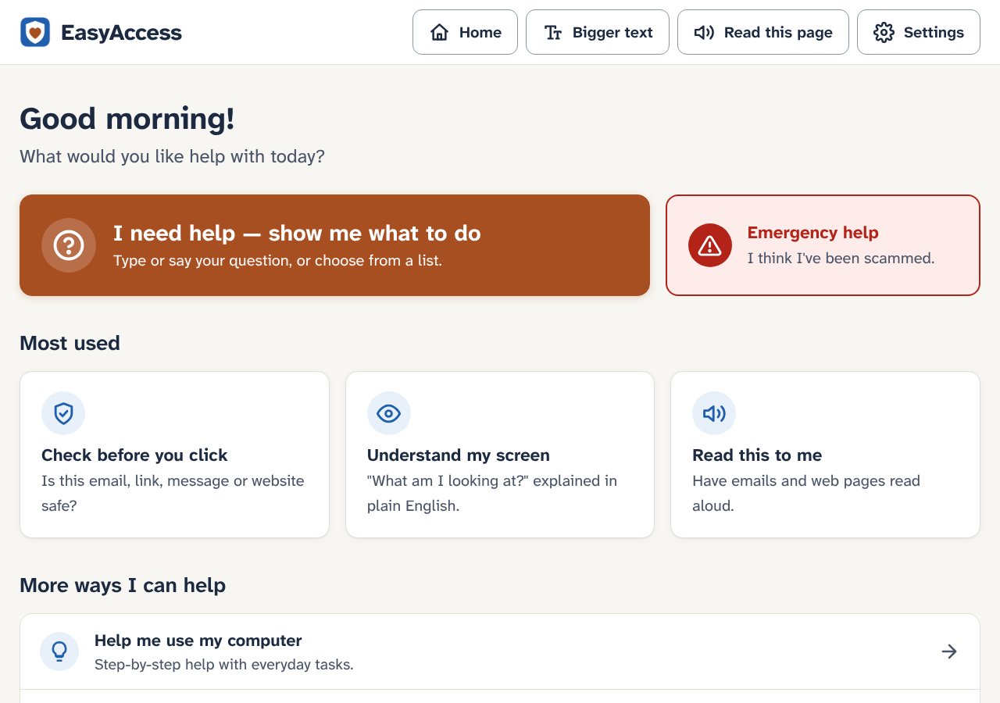

# EasyAccess – The Senior Digital Companion

> **"You don't have to understand computers. Just tell us what you need help with."**

EasyAccess is a Chrome extension that works like a patient family member sitting beside you: it checks emails, messages and websites for scams, explains what's on your screen in plain English, reads things aloud, teaches everyday computer tasks one step at a time, and guides you calmly if something goes wrong.

It works **immediately after installing — no account, no server, no internet service required**. An optional helper server adds a conversational AI assistant (Claude) and website threat-list checks, while keeping API keys out of the extension.



## What it does

| | |
|---|---|
| 🧡 **I need help – show me what to do** | Type or speak a question in your own words, or pick a common problem. A built-in **machine-learning model runs inside the extension** (no internet needed): it understands everyday wording and typos across 34 topics, asks "Did you mean…?" when unsure, and **learns from your corrections** on your own computer. The optional AI answers anything. |
| 🛡️ **Check before you click** | Paste an email, text or link → **Green / Yellow / Red** with plain reasons and what to do. Links are checked without opening them. Phone, QR code, online shop and scam-type guides. |
| 👁️ **Understand my screen** | "What am I looking at?" explains the current page: what site it is, what it asks for, what each button does, what's risky, what to do next. Spots fake virus alerts. Optional screenshot help. |
| ✉️ **Help me with email** | One-click "Is this email safe?" in Gmail, plain-English summaries, dates, requested actions, jargon explained, reply drafts you copy yourself. |
| 💡 **Help me use my computer** | 24 step-by-step lessons (tabs, downloads, printing, Wi-Fi, video calls, attachments…) with Windows/Mac/Chromebook wording, keyboard pictures, read-aloud and "I'm still confused". |
| 🔊 **Read this to me** | Reads web pages with paragraph highlighting and a big control bar (pause, slower, faster, skip), or any pasted text. |
| 🔎 **Find what I need** | 50 important websites with verified official addresses (Social Security, Medicare, IRS, fraud reporting…), plus your own favourites on the home screen. |
| 📹 **Help me connect** | One-click email and video calls with your people, guides, and how to spot fake "family" messages. |
| 🔐 **My security center** | Password and two-step sign-in lessons, safety checklist, scam quiz, reminders, computer dictionary. |
| 👪 **Trusted family help** | Ask a trusted person to check something — you review exactly what's sent, it goes through your own email, and every share is logged. No passwords or remote control, ever. |
| 🚨 **Emergency help** | Ten calm, tick-off pathways ("I sent money", "Someone accessed my computer"…) with official resources (ReportFraud.ftc.gov, IdentityTheft.gov, ic3.gov, Elder Fraud Hotline). |
| ⚙️ **Make everything easier to see** | Four text sizes (never below 18px), light/dark/high-contrast, reduced motion, simple home screen, voice settings, full keyboard and screen-reader support. |
| 🧭 **Protect me on every website** (optional) | Stops clicks on dangerous links, shows a calm banner on fake virus pages, warns before typing a password on a look-alike site, colours the toolbar button, and blocks clearly dangerous addresses with a warning page. |

**EasyAccess never clicks, buys, sends, forwards or deletes anything for you, and never asks for passwords or bank details.**

## Quick start

1. `chrome://extensions` → turn on **Developer mode** → **Load unpacked** → choose the `extension/` folder.
2. Pin the EasyAccess button (jigsaw-puzzle icon → pin).
3. Follow the welcome tour.

Full instructions, helper-server setup and development notes: **[docs/INSTALL.md](docs/INSTALL.md)**.

## Project layout

```
extension/            The Chrome extension (Manifest V3, no build step)
  manifest.json
  background/         Service worker: right-click menus, protection, badge, warning page, reminders
  popup/              Toolbar popup — quick help for the page you're on
  dashboard/          Full app (hash router + one view per section)
  engine/             Local scam engine + page explainer (also used by tests)
  content/            Read-aloud bar, optional website guard
  shared/             Design system CSS, settings, storage, speech, AI client, icons, page reader
  data/               Lessons, website directory, emergency pathways, glossary, quiz, helper answers,
                      intent-model.json (the trained helper model)
  warning/            Full-page "Stop — this website looks dangerous"
backend/              Optional helper server (Claude API + Google Safe Browsing)
tests/                Engine, classifier, backend and end-to-end browser tests
tools/                Model training (train-intents.mjs + intent-data.mjs), icon renderer
docs/                 Architecture, install, privacy & security, services, testing, screenshots
```

## Documentation

- [Dashboard design & technical architecture](docs/ARCHITECTURE.md)
- [Installation, configuration & development](docs/INSTALL.md)
- [Privacy, security & responsible AI](docs/PRIVACY.md)
- [Features that need API keys, servers or permissions](docs/SERVICES.md)
- [Testing (automated + senior scenarios + manual checklist)](docs/TESTING.md)

## Tests

```bash
npm install && (cd backend && npm install)
npm test            # 33 unit/integration tests
npm run train       # retrain the helper's machine-learning model
npm run test:e2e    # 21 browser tests with the real extension
```

## Honest limitations

Automated checks find common warning signs; they can miss new scams, and a green result is never a guarantee. The AI helper is optional and can make mistakes; EasyAccess's local checks always run as well. See [docs/PRIVACY.md](docs/PRIVACY.md#limitations-stated-honestly-in-the-app).
